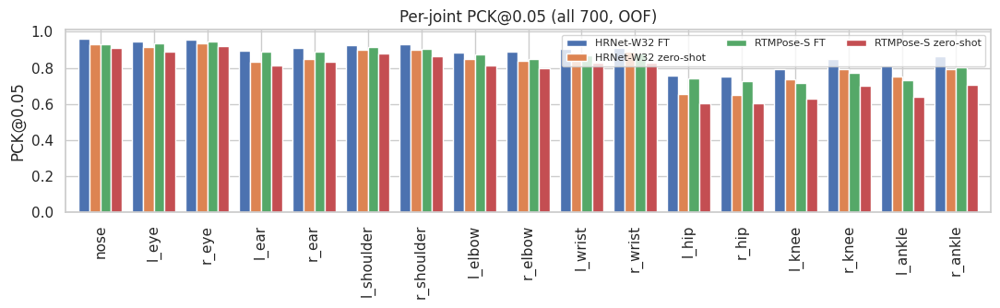
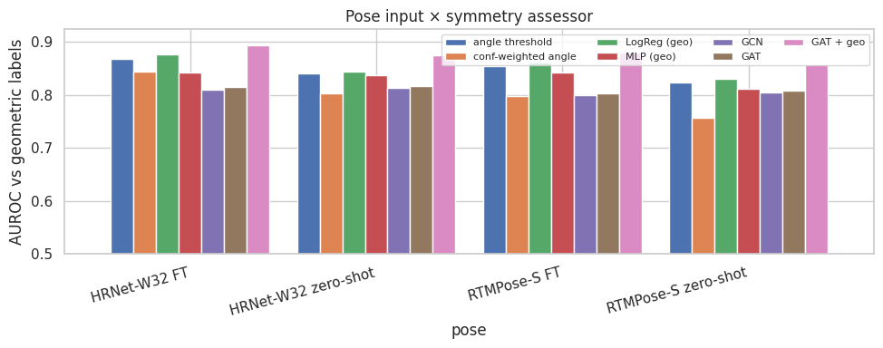
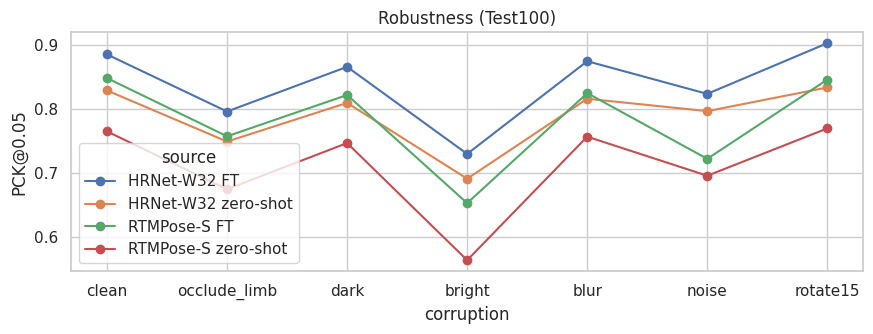
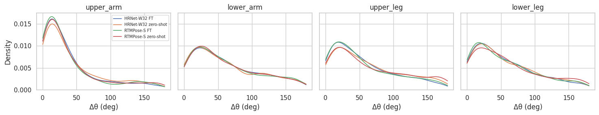
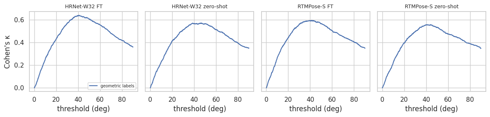
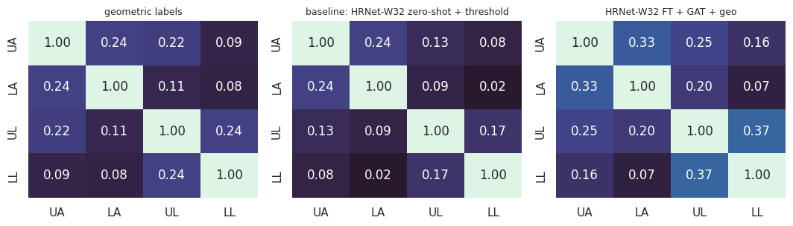
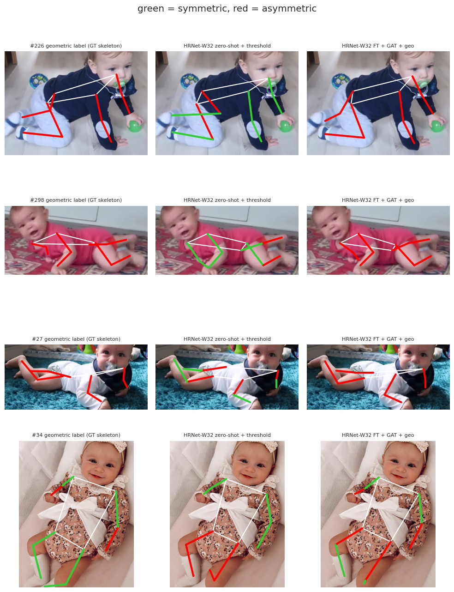
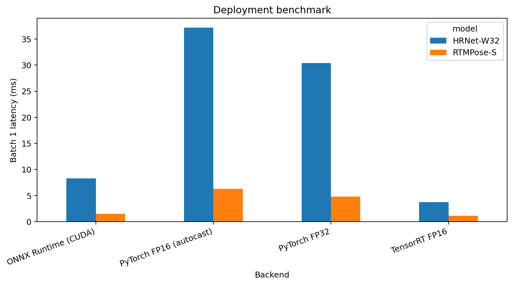
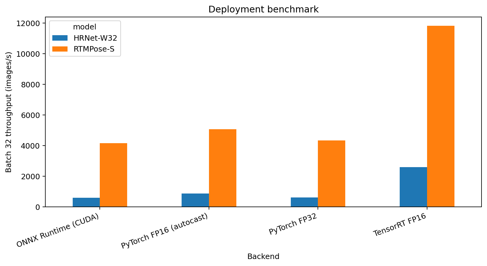

# Infant Pose Estimation and Postural Symmetry Assessment

A reproducible computer vision pipeline for infant pose estimation and bilateral postural symmetry assessment on expanded SyRIP.

This project extends the WACV 2023 infant postural symmetry pipeline by Huang et al. The original work assessed symmetry from infant pose geometry and calibrated angle based decisions against aggregated human ratings. This implementation keeps the pose based and geometry based foundation, then adds modern 2D pose models, grouped cross validation, learned graph based symmetry models, robustness testing, confidence analysis, and statistical comparison.

## Project summary

The pipeline has two main stages.

1. Estimate 17 infant body keypoints from a single RGB image.
2. Assess bilateral symmetry for upper arms, lower arms, upper legs, and lower legs.

Two modern MMPose models are evaluated.

- HRNet-W32
- RTMPose-S

Each model is evaluated in zero shot form and after SyRIP fine tuning. The symmetry stage compares fixed angle thresholds with learned baselines and graph neural networks.

## What is changed from the WACV 2023 pipeline

The WACV 2023 work used infant pose estimates, bilateral angle differences, Bayesian aggregation of human annotations, and an optimized angle threshold for postural symmetry assessment. The paper also studied 3D infant pose and reported that infant specific 3D pose improved agreement with aggregated human labels.

This repository adds the following components.

### 1. Modern 2D infant pose backbones

The notebook fine tunes HRNet-W32 and RTMPose-S on SyRIP rather than using only the original FiDIP pose estimator.

Both zero shot and fine tuned models are retained so the effect of infant domain adaptation can be measured directly.

### 2. Grouped five fold evaluation

Images are split with `StratifiedGroupKFold`.

The source video is used as the group identifier, so frames from the same source video cannot appear in both train and validation folds. Posture is used for stratification.

### 3. Synthetic and extra real training data

Synthetic SyRIP samples can be added to every training fold.

Real annotated samples that are outside the 700 image evaluation set can also be used as additional training data.

### 4. Learned symmetry assessors

The original angle threshold is retained as a baseline.

Additional symmetry assessors include:

- confidence weighted angle score
- logistic regression on geometric pose features
- multilayer perceptron on geometric pose features
- graph convolutional network
- graph attention network
- graph attention network with explicit geometric features

### 5. Graph representation of infant pose

The graph model treats each of the 17 body joints as a node.

Normal skeleton edges are supplemented by optional left right mirror edges. The readout compares corresponding left and right limb embeddings before predicting symmetry and three level angle classes.

### 6. Flip consistency regularization

The graph model is trained with a flip consistency objective.

Predictions from the original skeleton and the horizontally flipped skeleton are encouraged to agree after left right joint remapping.

### 7. Pose confidence and geometric features

The learned symmetry models can use:

- normalized keypoint coordinates
- keypoint confidence
- bilateral angle difference
- left right limb length ratio
- torso orientation
- shoulder and hip width
- canonicalized skeleton coordinates

### 8. Robustness evaluation

Pose models are evaluated under controlled image corruptions.

- limb occlusion
- dark exposure
- bright exposure
- blur
- Gaussian noise
- 15 degree rotation

The notebook also measures flip consistency error as a label free reliability signal.

### 9. Statistical comparison

Symmetry AUROC confidence intervals are estimated with cluster bootstrap resampling at the source video level.

The best learned model is also compared against the baseline with a paired cluster bootstrap test.

### 10. Deployment with ONNX and TensorRT

The fine tuned fold 0 pose networks are exported to ONNX with opset 17 and evaluated with ONNX Runtime CUDA and TensorRT. The MMPose preprocessing and decoding steps are kept unchanged, so the benchmark isolates the network backend.

The deployment path adds:

- dynamic batch ONNX export
- ONNX Runtime CUDA inference with I/O binding
- TensorRT engines with dynamic batch profiles
- FP16 TensorRT execution
- selective FP32 precision for sensitive prediction head layers
- batch 1 latency benchmarking
- batch 32 throughput benchmarking
- PCK parity checks against PyTorch FP32
- mean and maximum keypoint deviation from PyTorch FP32

RTMPose-S required special care in TensorRT. A pure FP16 engine produced non finite outputs in the prediction head. The final TensorRT configuration keeps sensitive `final_layer`, `mlp`, `gau`, `cls_x`, and `cls_y` layers in FP32 while the rest of the network uses FP16.

## Pipeline

```text
Infant RGB image
        |
        v
HRNet-W32 or RTMPose-S
        |
        v
17 keypoints + confidence
        |
        +-----------------------------+
        |                             |
        v                             v
bilateral geometry              canonical skeleton
        |                             |
        +-------------+---------------+
                      |
                      v
             symmetry assessor
       threshold / LR / MLP / GCN / GAT
                      |
                      v
     4 limb symmetry predictions
     + 3 level angle predictions
```

## Results from the uploaded experiment notebook

The uploaded notebook ran in geometric label mode because the WACV human survey files were not available in the local expanded SyRIP archive.

### Pose estimation on SyRIP test500

| Pose model | AP | PCK@0.05 |
| --- | ---: | ---: |
| HRNet-W32 fine tuned | 0.909 | 0.872 |
| HRNet-W32 zero shot | 0.853 | 0.827 |
| RTMPose-S fine tuned | 0.878 | 0.841 |
| RTMPose-S zero shot | 0.799 | 0.778 |

Fine tuning improved both HRNet-W32 and RTMPose-S on the held out SyRIP test500 subset.



### Symmetry assessment

The strongest configuration in the uploaded notebook was HRNet-W32 fine tuned with GAT plus geometric features.

| Pose input | Symmetry assessor | AUROC | Cohen kappa | Weighted angle kappa |
| --- | --- | ---: | ---: | ---: |
| HRNet-W32 fine tuned | GAT + geometry | 0.894 | 0.609 | 0.688 |
| RTMPose-S fine tuned | GAT + geometry | 0.880 | 0.595 | 0.656 |
| HRNet-W32 fine tuned | Logistic regression + geometry | 0.877 | 0.592 | 0.661 |
| HRNet-W32 fine tuned | Angle threshold | 0.869 | 0.634 | 0.690 |
| HRNet-W32 zero shot | Angle threshold | 0.840 | 0.556 | 0.626 |

The paired cluster bootstrap comparison in the notebook gave a +0.054 AUROC difference between HRNet-W32 fine tuned with GAT plus geometry and the HRNet-W32 zero shot angle threshold baseline on all 700 images. The 95 percent interval was +0.043 to +0.068.



### GAT ablation

| Variant | AUROC | Cohen kappa | Weighted angle kappa |
| --- | ---: | ---: | ---: |
| GAT + geometry | 0.894 | 0.609 | 0.688 |
| no mirror edges | 0.894 | 0.614 | 0.684 |
| no flip consistency loss | 0.893 | 0.604 | 0.691 |
| plain GAT without geometry | 0.815 | 0.489 | 0.529 |

The main gain came from combining graph features with explicit bilateral geometry.

### Robustness



The fine tuned HRNet-W32 model was strongest across most corruptions in the uploaded experiment.

### Bilateral angle distributions



### Threshold analysis



### Inter limb agreement



### Qualitative symmetry predictions

Green limbs are predicted symmetric. Red limbs are predicted asymmetric.



## Deployment benchmark

The updated notebook exports the fine tuned fold 0 pose models to ONNX and benchmarks PyTorch, ONNX Runtime CUDA, and TensorRT on the same preprocessed tensors. Flip test is disabled for all deployment backends.

| Model | Backend | Batch 1 latency, ms | Batch 32 throughput, img/s | PCK@0.05 | Speedup vs FP32 |
| --- | --- | ---: | ---: | ---: | ---: |
| RTMPose-S | PyTorch FP32 | 4.779 | 4331.677 | 0.848 | 1.000x |
| RTMPose-S | PyTorch FP16 autocast | 6.310 | 5065.362 | 0.849 | 0.757x |
| RTMPose-S | ONNX Runtime CUDA | 1.512 | 4160.516 | 0.847 | 3.162x |
| RTMPose-S | TensorRT FP16 with FP32 head constraints | 1.121 | 11813.986 | 0.848 | 4.265x |
| HRNet-W32 | PyTorch FP32 | 30.400 | 622.432 | 0.874 | 1.000x |
| HRNet-W32 | PyTorch FP16 autocast | 37.151 | 865.515 | 0.874 | 0.818x |
| HRNet-W32 | ONNX Runtime CUDA | 8.272 | 599.248 | 0.874 | 3.675x |
| HRNet-W32 | TensorRT FP16 with FP32 head constraints | 3.725 | 2593.465 | 0.873 | 8.162x |

The TensorRT backend reduced batch 1 latency from 4.779 ms to 1.121 ms for RTMPose-S and from 30.400 ms to 3.725 ms for HRNet-W32. PCK@0.05 changed by at most 0.001 in these deployment runs.





The full measured table, including keypoint deviation from PyTorch FP32, is stored in `results/metrics/deployment_benchmark.csv`.

### TensorRT precision diagnostic

The updated notebook also includes a TensorRT diagnostic for RTMPose-S. A TensorRT FP32 engine remained numerically stable, while a pure FP16 engine produced non finite values in both output tensors. This motivated the mixed precision TensorRT engine used in the final benchmark. Sensitive prediction head layers are forced to FP32 and the remaining layers are allowed to run in FP16.

## Repository structure

```text
.
├── assets/
│   ├── metrics/
│   ├── predictions/
│   ├── robustness/
│   └── symmetry/
├── checkpoints/
├── configs/
├── data/
│   ├── annotations/
│   ├── processed/
│   ├── raw/
│   └── splits/
├── deploy/
├── docs/
├── notebooks/
├── results/
│   ├── metrics/
│   ├── plots/
│   ├── predictions/
│   └── tables/
├── scripts/
├── slurm/
├── src/
│   └── infant_pose_symmetry/
└── tests/
```

## Data

The image dataset is not included in this repository.

Place expanded SyRIP outside the Git repository or under `data/raw/expanded_SyRIP/`.

The code searches COCO keypoint JSON files recursively and resolves the corresponding image files.

Recommended local layout:

```text
data/
└── raw/
    └── expanded_SyRIP/
        ├── ...
        ├── real images
        ├── synthetic images
        └── COCO keypoint annotation JSON files
```

The exact expanded SyRIP archive structure can vary. The loader does not require one fixed internal directory name.

Optional WACV 2023 files are detected automatically if they are available:

```text
AsymmetryAnalysis*.xlsx
img_name700_map.npy
keypoints_validate_infant_results*.json
output_pose_3D.npy
output_imgnames.npy
correct_3D.npy
```

If the human survey file and image name map are not available, the pipeline uses geometric labels derived from ground truth 2D keypoints and the 39.1 degree threshold used in the original paper analysis.

## Installation

Python 3.10 or 3.11 is recommended.

Create the environment:

```bash
conda env create -f environment.yml
conda activate infant-symmetry
```

Install this repository:

```bash
pip install -e .
```

MMPose and MMEngine versions can be sensitive to CUDA and PyTorch versions. See `docs/compute_canada.md` for the cluster setup used by this project structure.

For ONNX deployment, install the deployment extras:

```bash
pip install -e ".[deploy]"
```

TensorRT must match the CUDA driver and GPU environment. Install the NVIDIA TensorRT package appropriate for the cluster or workstation instead of pinning a universal TensorRT version in this repository.

## Download MMPose checkpoints

On a machine with internet access:

```bash
mkdir -p checkpoints/mmpose

mim download mmpose \
  --config rtmpose-s_8xb256-420e_coco-256x192 \
  --dest checkpoints/mmpose

mim download mmpose \
  --config td-hm_hrnet-w32_8xb64-210e_coco-256x192 \
  --dest checkpoints/mmpose
```

## Run the project

### 1. Inspect the dataset

```bash
python scripts/inspect_dataset.py \
  --data-dir data/raw/expanded_SyRIP
```

### 2. Prepare grouped folds and COCO files

```bash
python scripts/prepare_data.py \
  --data-dir data/raw/expanded_SyRIP \
  --project-dir .
```

### 3. Generate MMPose fine tuning configs

```bash
python scripts/build_pose_configs.py \
  --project-dir . \
  --checkpoint-dir checkpoints/mmpose
```

### 4. Train pose models

```bash
python scripts/train_pose.py \
  --project-dir . \
  --model HRNet-W32 \
  --fold 0
```

Repeat for folds 0 through 4 and for both models.

### 5. Run pose inference

```bash
python scripts/run_pose_inference.py \
  --project-dir . \
  --model HRNet-W32 \
  --mode finetuned
```

### 6. Evaluate pose predictions

```bash
python scripts/evaluate_pose.py \
  --project-dir .
```

### 7. Train and evaluate symmetry models

```bash
python scripts/train_symmetry.py \
  --project-dir .
```

### 8. Generate README figures

```bash
python scripts/generate_figures.py \
  --project-dir .
```

### 9. Export a fine tuned pose model to ONNX

```bash
python scripts/export_onnx.py \
  --project-dir . \
  --model RTMPose-S \
  --fold 0
```

### 10. Benchmark PyTorch, ONNX Runtime and TensorRT

```bash
python scripts/benchmark_deployment.py \
  --project-dir . \
  --fold 0
```

The benchmark writes `results/metrics/deployment_benchmark.csv`. ONNX files and TensorRT engine files are stored under `deploy/` and are ignored by Git because they are generated model artifacts.

### 11. Diagnose TensorRT precision

```bash
python scripts/diagnose_tensorrt.py \
  --project-dir . \
  --model RTMPose-S \
  --fold 0
```

## Compute Canada

SLURM templates are included under `slurm/`.

Cluster paths should not be committed. Put local paths in environment variables or in an ignored file named `.env`.

Example:

```bash
export SYRIP_DIR=$SCRATCH/SyRIP
export CKPT_DIR=$SCRATCH/mmpose_ckpts
export PROJECT=$SCRATCH/infant_symmetry
```

## Files still needed from the original Compute Canada run

The notebook contains the numerical outputs and embedded plots, so the repository already includes the main reported results.

For a fully reproducible release with the exact trained models, copy these from Compute Canada if available:

```text
$PROJECT/work_dirs/
$PROJECT/configs/
$PROJECT/outputs/pose_predictions/
$PROJECT/outputs/pose_metrics.csv
$PROJECT/outputs/flip_consistency.csv
$PROJECT/outputs/robustness_pck.csv
$PROJECT/outputs/gat_ablation.csv
$PROJECT/outputs/symmetry_results_full.csv
$PROJECT/outputs/summary.json
$PROJECT/outputs/deployment_benchmark.csv
$PROJECT/deploy/*.onnx
$PROJECT/deploy/*.engine
$PROJECT/outputs/results_cache_*.pkl
```

The most valuable files are the best checkpoints under each `work_dirs/<model>_fold*/` directory and the cached pose prediction PKL files. Those are enough to reproduce evaluation without retraining pose models.

Do not upload the expanded SyRIP image archive to this repository unless its dataset license explicitly permits redistribution.

## Reference

This project extends:

Xiaofei Huang, Michael Wan, Lingfei Luan, Bethany Tunik, Sarah Ostadabbas.  
"Computer Vision to the Rescue: Infant Postural Symmetry Estimation From Incongruent Annotations."  
WACV 2023, pages 1909 to 1917.

Paper: https://openaccess.thecvf.com/content/WACV2023/html/Huang_Computer_Vision_to_the_Rescue_Infant_Postural_Symmetry_Estimation_From_WACV_2023_paper.html

Original repository: https://github.com/ostadabbas/Infant-Postural-Symmetry

SyRIP and FiDIP work should also be cited when their data, models, or annotations are used.

## Important note about the current results

The uploaded notebook reports `LABEL_MODE = geometric`.

This means the current numerical symmetry results are evaluated against geometric labels derived from ground truth keypoints, not against the original WACV human survey aggregate.

If you later add `AsymmetryAnalysis*.xlsx` and `img_name700_map.npy`, the same code can run in human label mode and produce a closer comparison with the WACV 2023 study.

## License

The original code in this repository is provided under a restrictive All Rights Reserved license.

Viewing the repository does not grant permission to copy, modify, distribute, publish, sublicense, sell, or reuse the original source code.

Third party datasets, pretrained models, libraries, and code retain their own licenses and copyrights.

See [LICENSE](LICENSE) and [NOTICE](NOTICE).
